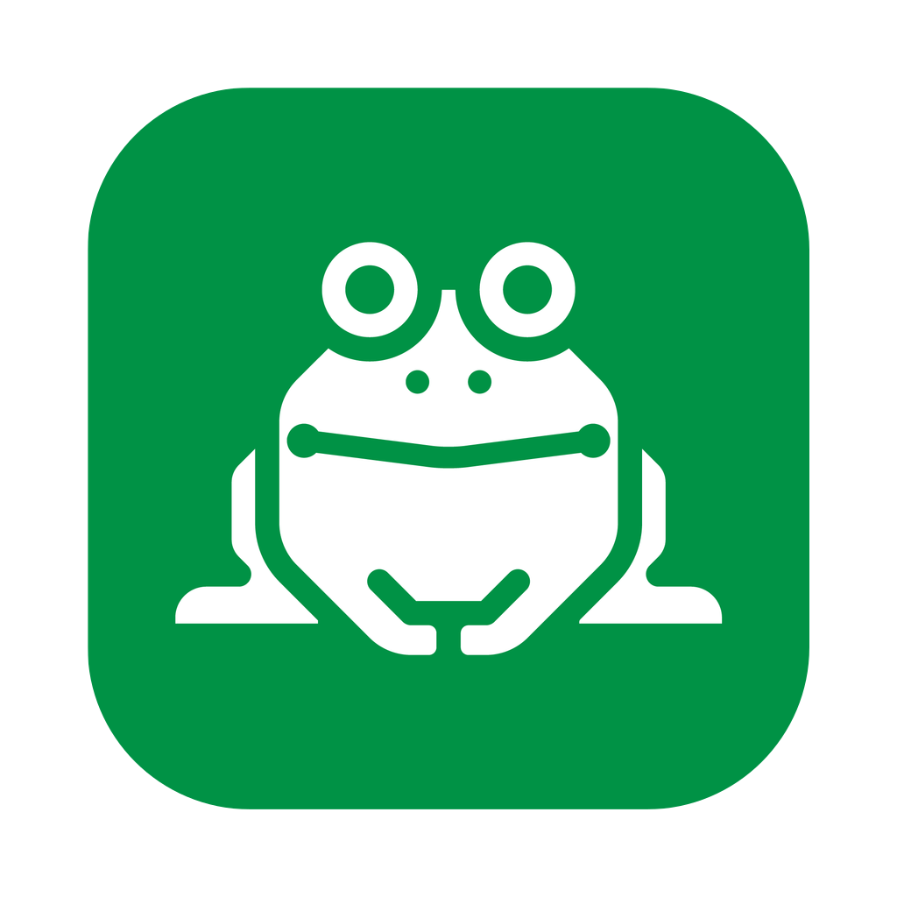

  

## Support the project

https://buymeacoffee.com/sindrevatnw

## Download

Latest version can be downloaded [here](https://github.com/SindreVatnaland/Froggi/releases/latest)

Installer downloads (.exe, .dmg, .AppImage) of every release, auto-updates included — refreshed every 6 hours.

## Credits

The replay / live game viewer is a port of [SlippiLab](https://github.com/frankborden/slippilab) by Frank Borden (MIT — [license](frontend/static/licenses/slippilab.txt)).

## Discord

Got any questions or feedback. Maybe want to contribute? Join our [Discord](https://discord.gg/rX7aQmbrEa)

## Installation

1. Make sure to have [Node](https://nodejs.org/en) installed
2. Run `npm run install:all` in root directory (Custom command for installing svelte+electron dependencies)
3. Run `npm run dev` to run the application

## Electron

Electron is the backend of the application and stores settings and temporary data in `Electron Store` (Json database). All data displayed in the frontend comes from Electron. Electron is the source of truth and provides consistency between all devices.

For larger data structure `Froggi` uses a `SQLite` database. It is light weight and allows for storing lots of data without slowing the application down. It is currently being used to store overlays, player data and game history.

Any data sent from Electron to the client is using a generalized `EventListener` which emits any event to both Electron and the external clients using Ipc and WebSockets respectfully.

## Svelte

Svelte is the UI of the application and utilizes svelte's built in `Store API` to communicate data throughout the app using a global `EventListener` to receive or send events anywhere in the application. The `EventListener` is generalized between Electron and Svelte and handles events equally between every device.

## Self Served Functionality

Being able to open the app on external devices requires the electron app to serve itself. This is accomplished in the dev environment by utilizing the `vite server` url. In production we first build the Svelte application before bundling it in the final electron build and serving the app utilizing express on startup.

## Build Targets

`npm run build` should automatically target your OS and build the application.
